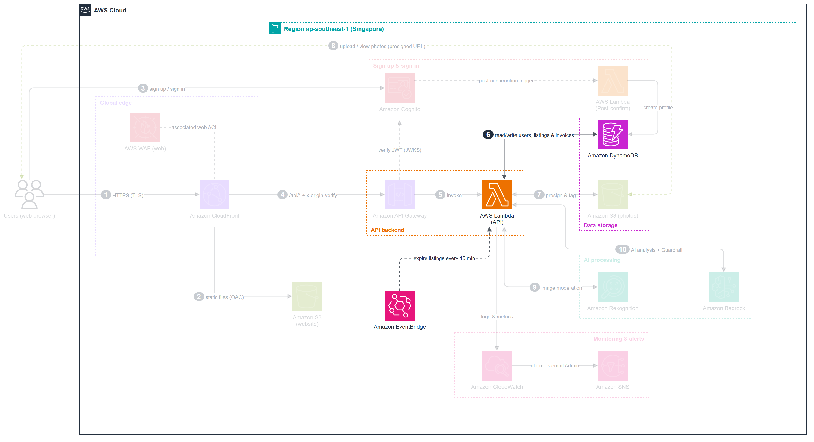
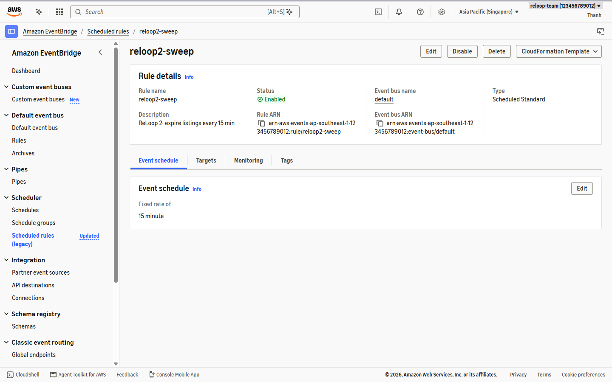
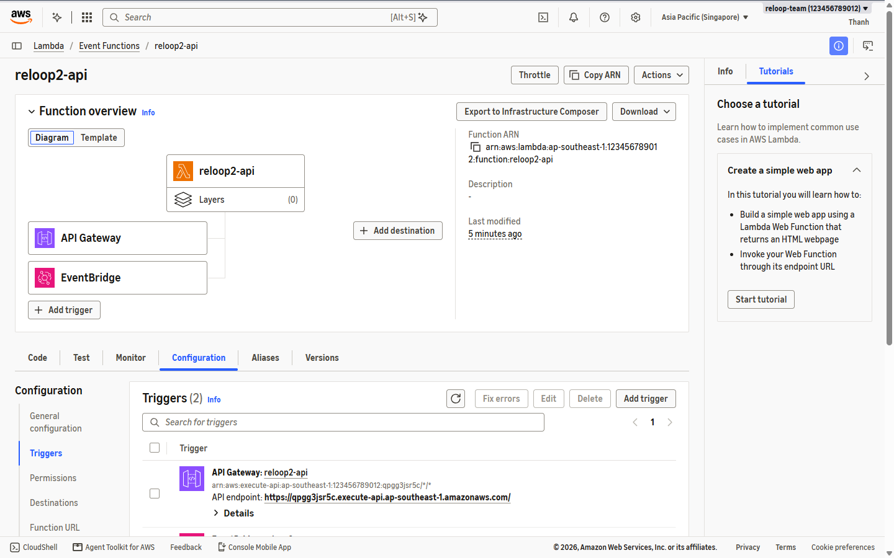

Add the scheduled background arrow on the diagram: **Amazon EventBridge** wakes up `reloop2-api` every 15 minutes to query `TIMER#` partitions in DynamoDB and automatically expire open listings past their 7-day window.

**Graph arrow covered in this step:**
- **Supporting link:** `Amazon EventBridge → AWS Lambda (API)` (`expire listings every 15 min`)

---

### Step 1 — Create Scheduled Rule `reloop2-sweep`

1. Open **Amazon EventBridge -> Buses -> Rules -> Create rule** in **`ap-southeast-1`**.
2. Configure:
   - **Name:** `reloop2-sweep`
   - **Description:** `ReLoop: expire listings every 15 min`
   - **Event bus:** `default`
   - **Rule type:** **`Schedule`** -> **Continue in EventBridge Rule**
   - **Schedule pattern:** **Fixed rate of `15` `Minutes`** (`rate(15 minutes)`)
3. Under **Select target(s)**:
   - **Target type:** `AWS service` -> **`Lambda function`**
   - **Function:** `reloop2-api`
   - *(The Console automatically attaches the resource-based invoke permission for `events.amazonaws.com` on `reloop2-api`.)*
4. Click **Create rule** and verify status is **Enabled**.

5. Open **AWS Lambda -> `reloop2-api` -> Configuration -> Triggers** and verify both diagram callers — **API Gateway** and **EventBridge** — appear in the function diagram.

{}
**The EventBridge sweep arrow is active.** Next, build the final pink box in [Module 5.10 — Monitoring & Alerts: CloudWatch & SNS](../5.10-monitoring/).
{}
