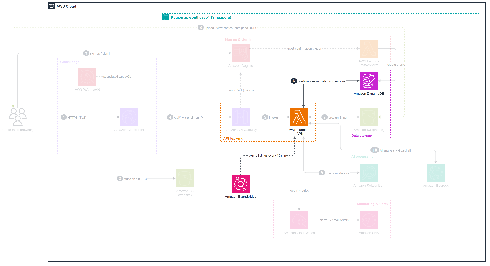
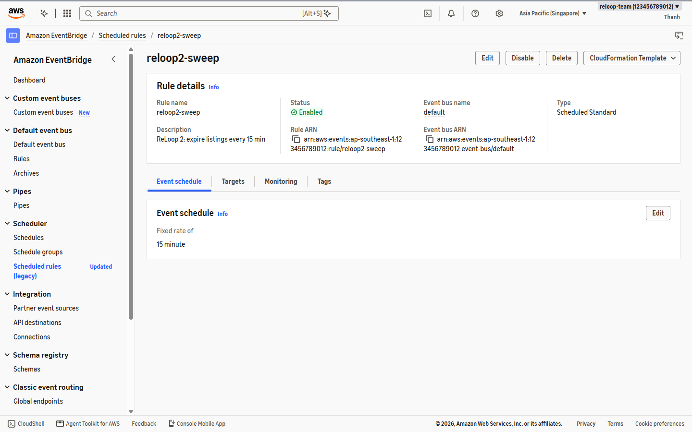
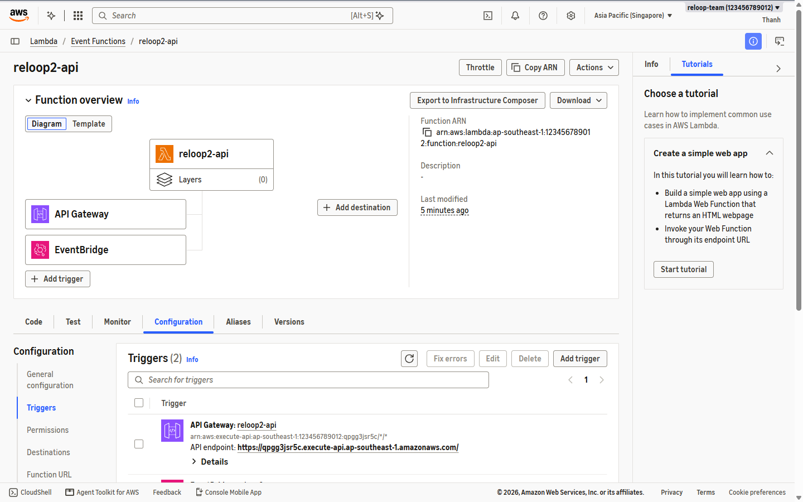

Bổ sung mũi tên chạy nền định kỳ trên sơ đồ: **Amazon EventBridge** đánh thức `reloop2-api` mỗi 15 phút để truy vấn các phân vùng `TIMER#` trong DynamoDB và tự động đóng (chuyển sang trạng thái hết hạn) những tin đăng đang mở đã quá 7 ngày.

**Mũi tên trên sơ đồ thuộc bước này:**
- **Liên kết phụ:** `Amazon EventBridge → AWS Lambda (API)` (`expire listings every 15 min`)

---

### Bước 1 — Tạo quy tắc định kỳ `reloop2-sweep`

1. Mở **Amazon EventBridge -> Buses -> Rules -> Create rule** tại **`ap-southeast-1`**.
2. Cấu hình:
   - **Name:** `reloop2-sweep`
   - **Description:** `ReLoop: expire listings every 15 min`
   - **Event bus:** `default`
   - **Rule type:** **`Schedule`** -> **Continue in EventBridge Rule**
   - **Schedule pattern:** **Fixed rate of `15` `Minutes`** (`rate(15 minutes)`)
3. Ở mục **Select target(s)**:
   - **Target type:** `AWS service` -> **`Lambda function`**
   - **Function:** `reloop2-api`
   - *(Console tự động thêm quyền gọi từ `events.amazonaws.com` trên `reloop2-api`.)*
4. Nhấn **Create rule** và kiểm tra trạng thái là **Enabled**.

5. Mở **AWS Lambda -> `reloop2-api` -> Configuration -> Triggers** để xác nhận đúng 2 nguồn kích hoạt như trên sơ đồ — **API Gateway** và **EventBridge**.

{}
**Mũi tên dọn tin định kỳ EventBridge đã sẵn sàng.** Tiếp theo, dựng khối màu hồng cuối cùng ở [Học phần 5.10 — Giám sát & Cảnh báo: CloudWatch & SNS](../5.10-monitoring/).
{}
